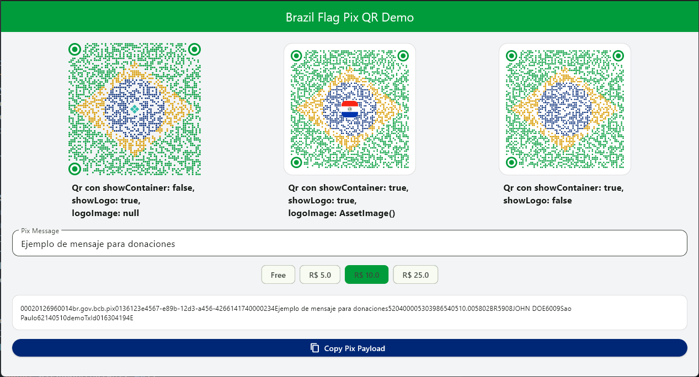
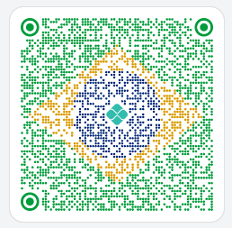

# brazil_flag_pix_qr 🇧🇷

[🇪🇸 Español](#-español) | [🇵🇾 Avañe'ẽ (Guaraní)](#-avañeẽ-guaraní) | [🇺🇸 English](#-english) | [🇧🇷 Português](#-português)


<p align="center">
  
</p>

---

<a name="español"></a>
## 🇪🇸 Español

Paquete en Flutter y Dart puro para generar payloads válidos de **Pix BR Code (EMV)** con soporte nativo para **mensajes/descripciones** y **txId**, acompañado de un widget personalizable que dibuja códigos QR con puntos circulares y los colores de la **bandera de Brasil**.

### Características

* **Generación exclusiva de Payload (`PixPayloadBuilder`):** Genera cadenas estándar *Pix Copia e Cola* sin depender de componentes visuales.
* **QR Personalizado Bandera de Brasil (`BrazilFlagQr`):** Dibuja códigos QR con puntos circulares verdes, rombo ámbar de alto contraste, círculo azul central, marcadores de esquina redondos en verde e ícono de Pix integrado.
* **Soporte para Mensaje y Referencia:** Calcula automáticamente el espacio disponible dentro del campo `26` (límite de 99 caracteres según la norma del Banco Central de Brasil) según la longitud de tu llave Pix.
* **Limpieza Automática de Texto:** Elimina tildes, diéresis y caracteres especiales no soportados, calculando la suma de verificación oficial **CRC16-CCITT (0xFFFF)**.

### Instalación

Agrega `brazil_flag_pix_qr` en tu archivo `pubspec.yaml`:

```yaml
dependencies:
  brazil_flag_pix_qr: ^1.0.0
```

### Formatos de Llave Pix soportados (`pixKey`)

La librería acepta los 5 tipos de llaves oficiales del Banco Central de Brasil:

| Tipo de Llave | Formato requerido | Ejemplo válido |
| :--- | :--- | :--- |
| **Llave Aleatoria (EVP)** | 36 caracteres con guiones | `'123e4567-e89b-12d3-a456-426614174000'` |
| **CPF** | 11 dígitos (sin puntos ni guiones) | `'12345678909'` |
| **CNPJ** | 14 dígitos (sin puntos, barras ni guiones) | `'12345678000195'` |
| **Teléfono celular** | Prefijo `+55` + DDD + 9 dígitos | `'+5511987654321'` |
| **Correo electrónico** | Dirección de email en minúsculas | `'usuario@ejemplo.com'` |


### Uso

#### 1. Generar solamente el Payload (Sin interfaz gráfica)
Usa `PixPayloadBuilder.generate` si solo necesitas obtener el texto *Pix Copia e Cola*:

```dart
import 'package:brazil_flag_pix_qr/brazil_flag_pix_qr.dart';

final String pixCopyPaste = PixPayloadBuilder.generate(
  pixKey: 'tu-llave-aleatoria-pix',
  merchantName: 'JUAN PEREZ',
  merchantCity: 'Sao Paulo',
  description: 'Apoyo al proyecto',
  txId: 'customTxId01',
  amount: 10.00, // Opcional: omítelo o pasa null para monto libre
);
```

#### 2. Renderizar el QR a partir de un Payload existente
```dart
import 'package:flutter/material.dart';
import 'package:brazil_flag_pix_qr/brazil_flag_pix_qr.dart';

BrazilFlagQr.fromPayload(
  payload: pixCopyPaste,
  size: 220,
)
```

#### 3. Widget Todo-en-Uno (Payload + QR Bandera)
```dart
BrazilFlagQr.pix(
  pixKey: 'tu-llave-aleatoria-pix',
  merchantName: 'JUAN PEREZ',
  merchantCity: 'Sao Paulo',
  description: 'Muchas gracias por tu apoyo',
  amount: 15.00,
  size: 220,
)
```

> **Nota:** La llave aleatoria incluida en la app de ejemplo (`example/`) es ficticia (solo para pruebas). Si deseas invitarme un café para apoyar el proyecto, utiliza los enlaces de PayPal o el QR de abajo. ☕

<a href="https://www.paypal.com/donate/?business=45GRDVDKNTYWJ&no_recurring=0&item_name=Con+tu+ayuda+seguimos+mejorando+ArandukApp+gratis+para+acercar+el+idioma+y+la+cultura+guaran%C3%AD+a+todos.+%C2%A1Aguyjevete%21&currency_code=USD">  Donar en USD con Paypal</a>
<br/>
<a href="https://www.paypal.com/donate/?business=45GRDVDKNTYWJ&no_recurring=0&item_name=Con+tu+ayuda+seguimos+mejorando+ArandukApp+gratis+para+acercar+el+idioma+y+la+cultura+guaran%C3%AD+a+todos.+%C2%A1Aguyjevete%21&currency_code=EUR">  Donar en EUR con Paypal</a>

<p><strong>O escanea este QR Pix para apoyar el proyecto:</strong></p>


---

<a name="guarani"></a>
## 🇵🇾 Avañe'ẽ (Guaraní)

Kóva ha'e peteĩ tembipuru Flutter ha Dart-pe guarã ojapóva **Pix BR Code (EMV)** ogueraháva **marandu (mensaje)** ha **txId**, avei oguereko peteĩ *widget* omoha'angáva kódigo QR apu'a'íva ha **Pindoráma poyvi (bandera)** sa'ykuéra reheve.

### Mba'emba'épa ojapo

* **Payload ñemoheñói año (`PixPayloadBuilder`):** Ojapo moñe'ẽrã *Pix Copia e Cola* oikotevẽ'ỹre ta'anga rehegua.
* **QR Pindoráma Poyvi Sa'y reheve (`BrazilFlagQr`):** Omoha'anga código QR apu'a hovyũ, sa'yju, hovy ha Pix ra'anga mbytépe.
* **Marandu ha Techaukaha:** Oipapa ijehegui mboy tai pa oñemoĩkuaa pe campo `26` ryepýpe (99 tai peve Banco Central de Brasil he'iháicha).
* **Moñe'ẽrã Ñemopotĩ:** Oipe'a ijehegui umi tai oñembojegua'íva (tildes) ha oipapa **CRC16-CCITT (0xFFFF)**.

### Ñemohenda (Instalación)

Emoĩ `brazil_flag_pix_qr` ne ñongatuha `pubspec.yaml` ryepýpe:

```yaml
dependencies:
  brazil_flag_pix_qr: ^1.0.0
```

### Pe'aha Pix oñemoneĩva (`pixKey`)

| Pe'aha Reko | Mba'éichapa oñemoĩva'erã | Techapyrã |
| :--- | :--- | :--- |
| **Pe'aha ojeiporavoreíva (EVP)** | 36 tai taiky reheve | `'123e4567-e89b-12d3-a456-426614174000'` |
| **CPF** | 11 papapy año (kyta ha taiky'ỹre) | `'12345678909'` |
| **CNPJ** | 14 papapy año | `'12345678000195'` |
| **Pumbyry (Teléfono)** | `+55` + DDD + 9 papapy | `'+5511987654321'` |
| **Ñe'ẽveve (Correo)** | Tai michĩvape | `'usuario@techapyra.com'` |

### Mba'éichapa ojepuru

#### 1. Emoheñói Payload añónte 
```dart
import 'package:brazil_flag_pix_qr/brazil_flag_pix_qr.dart';

final String pixCopyPaste = PixPayloadBuilder.generate(
  pixKey: "nde-pe'aha-ojeiporavoreíva-pix",
  merchantName: 'JUAN PEREZ',
  merchantCity: 'Sao Paulo',
  description: 'Agyuje reipytyvõ haguére',
  txId: 'customTxId01',
  amount: 10.00, // Ikatu reheja péva nandi pe ohepyme'ẽtava oiporavo hag̃ua mboypa ome'ẽta (opcional)

);
```

#### 2. QR ñemoha'anga Payload oĩmavagui
```dart
import 'package:flutter/material.dart';
import 'package:brazil_flag_pix_qr/brazil_flag_pix_qr.dart';

BrazilFlagQr.fromPayload(
  payload: pixCopyPaste,
  size: 220,
)
```

#### 3. Widget Oĩmbáva (Payload + QR Poyvi)
```dart
BrazilFlagQr.pix(
  pixKey: "nde-pe'aha-ojeiporavoreíva-pix",
  merchantName: 'JUAN PEREZ',
  merchantCity: 'Sao Paulo',
  description: 'Aguyjevete reipytyvõ haguére',
  amount: 15.00,
  size: 220,
)
```


> **Marandu:** Pe pe'aha ojeiporavoreíva oĩva techapyrãme (`example/`) ndaha'éi añetegua (ojepuru ojehechauka hag̃uánte). Reipota ramo eme'ẽ peteĩ kafe repy reipytyvõ hag̃ua, eipuru umi votõ PayPal térã pe QR oĩva iguýpe. ☕

<a href="https://www.paypal.com/donate/?business=45GRDVDKNTYWJ&no_recurring=0&item_name=Con+tu+ayuda+seguimos+mejorando+ArandukApp+gratis+para+acercar+el+idioma+y+la+cultura+guaran%C3%AD+a+todos.+%C2%A1Aguyjevete%21&currency_code=USD">  Me'ẽrei USD Paypal rupive</a>
<br/>
<a href="https://www.paypal.com/donate/?business=45GRDVDKNTYWJ&no_recurring=0&item_name=Con+tu+ayuda+seguimos+mejorando+ArandukApp+gratis+para+acercar+el+idioma+y+la+cultura+guaran%C3%AD+a+todos.+%C2%A1Aguyjevete%21&currency_code=EUR">  Me'ẽrei EUR Paypal rupive</a>

<p><strong>Térã embohasa ne pumbyry ko QR Pix rehe reipytyvõ hag̃ua ko tembiapóre:</strong></p>


---


<a name="english"></a>
## 🇺🇸 English

A Flutter and pure Dart package to generate valid **Pix BR Code (EMV)** payloads with native support for **messages/descriptions** and **txId**, paired with a customizable widget that renders QR codes styled with circular dots and the geometry of the **Brazilian flag**.

### Features

* **Payload-Only Generation (`PixPayloadBuilder`):** Generate standard Pix *Copia e Cola* strings with zero UI dependencies.
* **Custom Brazilian Flag QR (`BrazilFlagQr`):** Render QR codes with green circular dots, high-contrast amber diamond, blue center circle, rounded green corner markers, and an integrated Pix icon.
* **Message & Reference Support:** Automatically calculates the remaining space inside field `26` (99-character limit per Banco Central do Brasil specs) based on your Pix key length.
* **Automatic Text Sanitization:** Strips accents, diacritics, and unsupported symbols while computing the exact **CRC16-CCITT (0xFFFF)** checksum.

### Installation

Add `brazil_flag_pix_qr` to your `pubspec.yaml`:

```yaml
dependencies:
  brazil_flag_pix_qr: ^1.0.0
```

### Supported Pix Key Formats (`pixKey`)

The library supports all 5 official Pix key types defined by Banco Central do Brasil:

| Key Type | Required Format | Valid Example |
| :--- | :--- | :--- |
| **Random Key (EVP)** | 36 characters including hyphens | `'123e4567-e89b-12d3-a456-426614174000'` |
| **CPF** | 11 digits only (no dots or hyphens) | `'12345678909'` |
| **CNPJ** | 14 digits only (no punctuation) | `'12345678000195'` |
| **Mobile Phone** | `+55` prefix + area code (DDD) + 9 digits | `'+5511987654321'` |
| **Email** | Lowercase email address | `'user@example.com'` |


### Usage

#### 1. Generate Payload Only (No UI)
Use `PixPayloadBuilder.generate` if you only need the *Pix Copia e Cola* string:

```dart
import 'package:brazil_flag_pix_qr/brazil_flag_pix_qr.dart';

final String pixCopyPaste = PixPayloadBuilder.generate(
  pixKey: 'your-random-pix-key',
  merchantName: 'JOHN DOE',
  merchantCity: 'Sao Paulo',
  description: 'Project support',
  txId: 'customTxId01',
  amount: 10.00, // Optional: omit or pass null for free amount
);
```

#### 2. Render QR Code from an Existing Payload
```dart
import 'package:flutter/material.dart';
import 'package:brazil_flag_pix_qr/brazil_flag_pix_qr.dart';

BrazilFlagQr.fromPayload(
  payload: pixCopyPaste,
  size: 220,
)
```

#### 3. All-in-One Widget (Payload + Flag QR)
```dart
BrazilFlagQr.pix(
  pixKey: 'your-random-pix-key',
  merchantName: 'JOHN DOE',
  merchantCity: 'Sao Paulo',
  description: 'Thank you for your support',
  amount: 15.00,
  size: 220,
)
```

> **Note:** The random key included in the `example/` app is a dummy key for testing purposes only. If you'd like to buy me a coffee to support the project, please use the PayPal links or the QR code below. ☕

<a href="https://www.paypal.com/donate/?business=45GRDVDKNTYWJ&no_recurring=0&item_name=Con+tu+ayuda+seguimos+mejorando+ArandukApp+gratis+para+acercar+el+idioma+y+la+cultura+guaran%C3%AD+a+todos.+%C2%A1Aguyjevete%21&currency_code=USD">  Donate in USD Paypal</a>
<br/>
<a href="https://www.paypal.com/donate/?business=45GRDVDKNTYWJ&no_recurring=0&item_name=Con+tu+ayuda+seguimos+mejorando+ArandukApp+gratis+para+acercar+el+idioma+y+la+cultura+guaran%C3%AD+a+todos.+%C2%A1Aguyjevete%21&currency_code=EUR">  Donate in EUR Paypal</a>

<p><strong>Or scan this Pix QR code to support the project:</strong></p>


---

<a name="portugues"></a>
## 🇧🇷 Português

Pacote em Flutter e Dart puro para gerar payloads válidos de **Pix BR Code (EMV)** com suporte nativo para **mensagens/descrições** e **txId**, acompanhado de um widget personalizável que desenha códigos QR com pontos circulares e as cores da **bandeira do Brasil**.

### Características

* **Geração exclusiva de Payload (`PixPayloadBuilder`):** Gera códigos padrão *Pix Copia e Cola* sem depender de componentes visuais.
* **QR Personalizado Bandeira do Brasil (`BrazilFlagQr`):** Desenha códigos QR com pontos circulares verdes, losango âmbar de alto contraste, círculo azul central, marcadores de canto redondos em verde e ícone do Pix integrado.
* **Suporte para Mensagem e Referência:** Calcula automaticamente o espaço disponível dentro do campo `26` (limite de 99 caracteres segundo a norma do Banco Central do Brasil) de acordo com o tamanho da sua chave Pix.
* **Limpeza Automática de Texto:** Remove acentos, cedilha e caracteres especiais não suportados, calculando a soma de verificação oficial **CRC16-CCITT (0xFFFF)**.

### Instalação

Adicione `brazil_flag_pix_qr` no seu arquivo `pubspec.yaml`:

```yaml
dependencies:
  brazil_flag_pix_qr: ^1.0.0
```

### Formatos de Chave Pix suportados (`pixKey`)

A biblioteca aceita os 5 tipos de chaves oficiais do Banco Central do Brasil:

| Tipo de Chave | Formato exigido | Exemplo válido |
| :--- | :--- | :--- |
| **Chave Aleatória (EVP)** | 36 caracteres com hífens | `'123e4567-e89b-12d3-a456-426614174000'` |
| **CPF** | 11 dígitos (sem pontos ou hífens) | `'12345678909'` |
| **CNPJ** | 14 dígitos (sem pontos, barras ou hífens) | `'12345678000195'` |
| **Telefone celular** | Prefixo `+55` + DDD + 9 dígitos | `'+5511987654321'` |
| **E-mail** | Endereço de e-mail em minúsculas | `'usuario@exemplo.com'` |

### Uso

#### 1. Gerar apenas o Payload (Sem interface gráfica)
Use `PixPayloadBuilder.generate` se precisar apenas obter o texto *Pix Copia e Cola*:

```dart
import 'package:brazil_flag_pix_qr/brazil_flag_pix_qr.dart';

final String pixCopyPaste = PixPayloadBuilder.generate(
  pixKey: 'sua-chave-aleatoria-pix',
  merchantName: 'JOAO SILVA',
  merchantCity: 'Sao Paulo',
  description: 'Apoio ao projeto',
  txId: 'customTxId01',
  amount: 10.00, // Opcional: omita ou passe null para valor livre
);
```

#### 2. Renderizar o QR a partir de um Payload existente
```dart
import 'package:flutter/material.dart';
import 'package:brazil_flag_pix_qr/brazil_flag_pix_qr.dart';

BrazilFlagQr.fromPayload(
  payload: pixCopyPaste,
  size: 220,
)
```

#### 3. Widget Tudo-em-Um (Payload + QR Bandeira)
```dart
BrazilFlagQr.pix(
  pixKey: 'sua-chave-aleatoria-pix',
  merchantName: 'JOAO SILVA',
  merchantCity: 'Sao Paulo',
  description: 'Muito obrigado pelo seu apoio',
  amount: 15.00,
  size: 220,
)
```

> **Nota:** A chave aleatória incluída no aplicativo de exemplo (`example/`) é fictícia (apenas para testes). Caso queira pagar um café para apoiar o projeto, utilize os links do PayPal ou o QR code abaixo. ☕

<a href="https://www.paypal.com/donate/?business=45GRDVDKNTYWJ&no_recurring=0&item_name=Con+tu+ayuda+seguimos+mejorando+ArandukApp+gratis+para+acercar+el+idioma+y+la+cultura+guaran%C3%AD+a+todos.+%C2%A1Aguyjevete%21&currency_code=USD">  Doar em USD com Paypal</a>
<br/>
<a href="https://www.paypal.com/donate/?business=45GRDVDKNTYWJ&no_recurring=0&item_name=Con+tu+ayuda+seguimos+mejorando+ArandukApp+gratis+para+acercar+el+idioma+y+la+cultura+guaran%C3%AD+a+todos.+%C2%A1Aguyjevete%21&currency_code=EUR">  Doar em EUR com Paypal</a>

<p><strong>Ou escaneie este QR Pix para apoiar o projeto:</strong></p>


---

